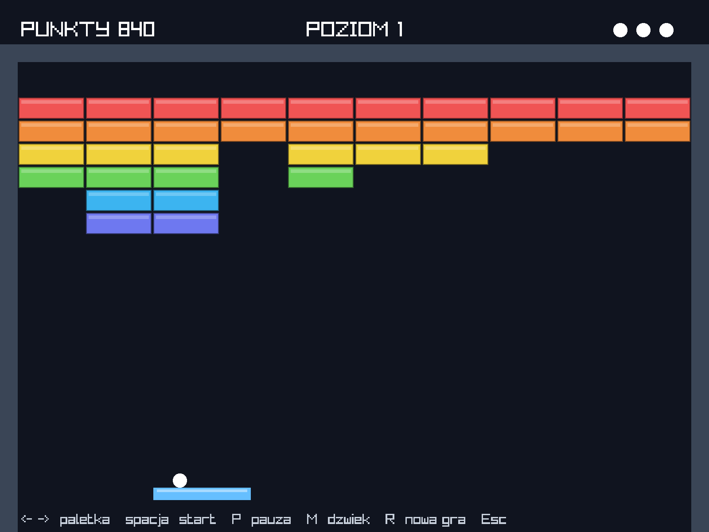
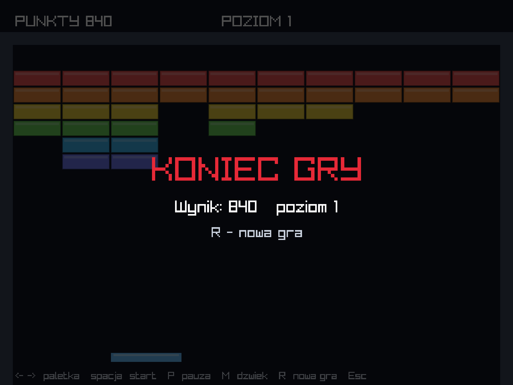

# Arkanoid w Ducklingu


Arkanoid (Breakout) napisany w Ducklingu. Paletką odbijasz piłkę i zbijasz cegły. Ruch piłki i zderzenia liczy pakiet `fizyka` (port Box2D 3.1.1), a gra reaguje na **zdarzenia zderzeń**, które fizyka zgłasza po każdym kroku. Okno, klawiatura, rysowanie i dźwięk pochodzą z pakietu `grafika` (raylib 5.5). Oba pakiety są z [duckling-biblioteki](https://github.com/andr729/duckling-biblioteki).





## Sterowanie

| Klawisz | Działanie |
|---|---|
| ← → albo A / D | paletka |
| spacja | start piłki z paletki |
| P | pauza |
| M | dźwięk włącz / wyłącz |
| R | nowa gra |
| Esc albo zamknięcie okna | wyjście |

## Zasady

* **3 życia.** Piłka za dolną krawędzią zabiera życie i wraca na paletkę.
* **Kąt odbicia od paletki zależy od miejsca trafienia:** środek odbija pionowo, a brzeg pod kątem do 60° od pionu.
* **Cegły:** zwykła daje 10–70 punktów (wyżej więcej), srebrna wymaga dwóch trafień, pęka po pierwszym i daje 50 punktów.
* **Poziomy:** pełny mur, piramida z twardym szczytem i szachownica z twardym pasem; potem układy wracają, a piłka jest szybsza. Za zbicie wszystkich cegieł jest premia 500 × poziom.
* **Szybkość piłki:** 7 m/s na 1. poziomie, +10% na każdy kolejny i +0,05 m/s za każdą zbitą cegłę, najwyżej 13 m/s. Co najmniej 30% prędkości przypada na ruch w pionie, żeby piłka nie krążyła poziomo między ścianami.
* **Dźwięki** przy zbiciu cegły, odbiciu, utracie piłki, nowym poziomie i końcu gry.

## Jak działa fizyka

* **Świat:** grawitacja zero, 50 pikseli na metr, punkt (0, 0) świata na środku dolnej krawędzi ekranu (piksel 400, 600), oś Y w górę.
* **Ciała:** ściany, sufit, cegły i paletka to nieruchome pudełka (`start.addBox`). Paletkę przestawia `gra.setTransform`.
* **Piłka:** dynamiczne koło bez tarcia, utworzone przez `gra.createBodyWithShape` z `enableContactEvents = true`. Box2D zgłasza zderzenie, gdy zdarzenia ma włączone choć jeden z kształtów, więc wystarczy włączyć je w piłce.
* **Zderzenia:** po każdym stałym kroku (1/60 s) `gra.copyContactEvents` daje listę zderzeń, które się zaczęły, z numerami kształtów i normalną kontaktu. Gra rozpoznaje po numerze, czy piłka trafiła w paletkę, w cegłę, czy w ścianę.
  * cegła traci wytrzymałość, a zbita znika (`gra.destroyBody`);
  * od cegły i ściany piłka odbija się według normalnej: v' = v − 2(v·n)n, liczone od prędkości sprzed kroku;
  * od paletki odbija się pod kątem zależnym od miejsca trafienia.

**Ciekawostka z portu Box2D:** w tej konfiguracji statyczna ściana zatrzymywała piłkę, zamiast ją odbić, mimo odbicia (restitution) = 1. Składowa prędkości w stronę ściany spadała do zera: 5,6 m/s → 0. Dlatego odbicie od ścian i cegieł liczy gra, ze zdarzenia zderzenia.

## Uruchomienie (macOS)

```sh
./uruchom.sh          # pierwszy raz przygotowuje raylib, grafikę i fizykę (~1,5 min), potem buduje i uruchamia grę
./uruchom.sh testy    # testy logiki i fizyki, bez okna
```

Pierwsza budowa z fizyką trwa około pół minuty. Kompilator wypisuje przy fizyce dużo ostrzeżeń „trivially copyable” z modułu `tasma.dk`; są niegroźne.

Wymagania:
* Duckling z `duck` w PATH (sprawdzone na `duckc 0.3-alpha (83882805a 2026-11-20)`, macOS 27.2, Apple Silicon);
* Xcode Command Line Tools (git, make, clang);
* duckling-biblioteki, gałąź `paczki-duck`, domyślnie w `~/duckling-biblioteki` (inna ścieżka: `./przygotuj_macos.sh /ścieżka`).

## Struktura

```
logika/        pakiet arkanoid_logika: świat fizyki, paletka, piłka, cegły, poziomy, zdarzenia zderzeń
gra/           pakiet arkanoid_gra: okno, klawiatura, rysowanie, dźwięk, pętla gry
gra/dzwieki/   próbki dźwięku CC0 z duckling-biblioteki (opis w ZRODLO.txt)
testy/         pakiet testy_arkanoida: 23 sprawdzenia bez okna, kod wyjścia = liczba błędów
zrzuty/        obrazy do README: w gra/ uruchom ARKANOID_ZRZUTY=1 ./.duck_build/dev/arkanoid_gra
przygotuj_macos.sh   raylib 5.5 oraz kopie pakietów grafika i fizyka dla macOS do zewnetrzne/ (poza gitem)
```

Testy sprawdzają między innymi:
* odbicie od ściany ze stałą szybkością;
* zbicie cegły z 6. wiersza (20 punktów) i odbicie w dół;
* kąt odbicia na środku i przy brzegu paletki oraz minimalny ruch w pionie;
* utratę piłki i koniec gry;
* srebrne cegły, przejście na kolejny poziom i liczby cegieł w układach;
* 15 s gry z automatem, który trzyma paletkę pod piłką: piłka nie ginie, a jej szybkość zawsze się zgadza;
* ten sam stan po tej samej liczbie stałych kroków przy 30 i 144 klatkach na sekundę.

`duck` trzyma jedno środowisko (venv) na nazwę pakietu. Druga kopia projektu na tym samym komputerze kończy się błędem „would overwrite the venv”: zmień w niej `name` w `quackconfig.yaml` albo dodaj `--overwrite`.

## Licencja

MIT. Kopie pakietów `grafika` i `fizyka` w `zewnetrzne/` pochodzą z duckling-biblioteki (MIT; fizyka jest portem Box2D, MIT, Erin Catto). raylib ma licencję zlib, a próbki dźwięku w `gra/dzwieki/` są na licencji CC0.
